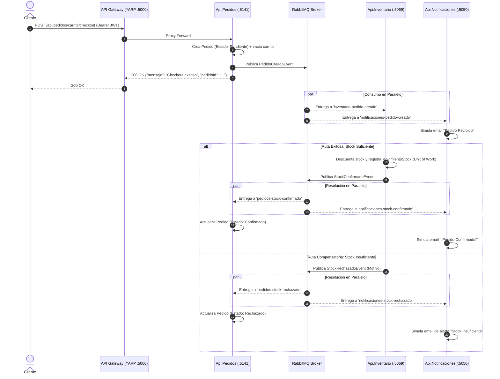

# E-Commerce Microservices Architecture

Proyecto de E-Commerce desarrollado bajo una **Arquitectura de Microservicios orientada a eventos**, diseñado bajo estándares empresariales (Cloud-Native / 12-Factor App) para ser desacoplado, resiliente y escalable. Implementa el patrón **Saga Coreografiado** sobre **RabbitMQ** y **MassTransit** para la gestión de transacciones distribuidas con consistencia eventual, y centraliza el acceso perimetral mediante un **API Gateway** con **YARP**, incorporando **Rate Limiting distribuido** y **Caché en Redis**.


---

## Documentación Técnica en Profundidad (Wiki)

Para comprender en detalle cada decisión de diseño, patrones implementados y modelos de datos:

1. [Introducción y Objetivos Arquitectónicos](./docs/01-introduccion.md)
2. [Arquitectura Orientada a Eventos y Patrón Saga](./docs/02-saga-rabbitmq.md)
3. [API Gateway (YARP) y Seguridad](./docs/03-componentes.md)
4. [Microservicios y Dominios](./docs/04-microservicios.md)
5. [Infraestructura y Estrategia de Despliegue](./docs/05-despliegue-e-infraestructura.md)

---

## Topología de Servicios

| Servicio | Responsabilidad | Puerto Host | Puerto Contenedor | Base de Datos | Tecnologías Clave |
| :--- | :--- | :---: | :---: | :---: | :--- |
| **Api.Gateway** | Reverse Proxy, Rate Limiting distribuido, Output Caching y RBAC | `5000` / `5204` | `8080` | — | YARP 2.3, StackExchange.Redis, JWT Bearer |
| **Api.Auth** | Identidad, autenticación, hasheo de credenciales (BCrypt) y emisión de JWT | `5259` | `8080` | PostgreSQL (`auth_db`) | EF Core 10, BCrypt.Net, MassTransit |
| **Api.Inventario** | Catálogo de productos, categorías y trazabilidad de movimientos de stock | `5069` | `8080` | PostgreSQL (`inventario_db`) | EF Core 10, MassTransit, Unit of Work |
| **Api.Pedidos** | Gestión de carritos activos, orquestación de checkout y órdenes de compra | `5141` | `8080` | PostgreSQL (`pedidos_db`) | EF Core 10, MassTransit, FixedWindow RateLimiter |
| **Api.Notificaciones** | Worker asíncrono para emisión simulada de alertas e emails transaccionales | `5050` | `8080` | — (Stateless) | MassTransit, Background Consumer |
| **PostgreSQL** | Motor de persistencia relacional con aislamiento físico por microservicio | `5432` | `5432` | 3 BDs lógicas | PostgreSQL 15 Alpine |
| **RabbitMQ** | Message Broker para eventos asíncronos con consola de administración | `5672` / `15672` | `5672` / `15672` | — | RabbitMQ 3 Management Alpine |
| **Redis** | Almacén en memoria para Rate Limiting distribuido y Output Caching | `6379` | `6379` | — | Redis 7 Alpine |

---

## Flujo Transaccional Distribuido (Checkout Saga)

El checkout implementa una **Saga Coreografiada**. No existe un orquestador central: cada servicio reacciona a eventos en colas dedicadas, ejecuta su transacción local en PostgreSQL y publica el resultado.



---

## Decisiones Técnicas y Patrones Arquitectónicos

* **Saga Coreografiada vs. Orquestada:** Se eligió coreografía para evitar que un orquestador central se convierta en un *Single Point of Failure (SPOF)* o cuello de botella bajo alta concurrencia. *Trade-off:* Requiere una disciplina estricta de idempotencia y contratos compartidos fuertemente tipados (`SharedContracts`).
* **Colas Dedicadas por Servicio (Fan-Out Real):** Cada consumidor se registra con un prefijo de servicio (ej. `pedidos-stock-confirmado`, `notificaciones-stock-confirmado`). Esto evita el problema de *competing consumers* en la misma cola y garantiza que tanto `Pedidos` como `Notificaciones` reciban copias independientes de los eventos de la Saga.
* **Fail-Fast en Middleware Pipeline:** El Rate Limiting de Redis en el Gateway se evalúa al principio del pipeline, antes de autenticación o autorización. Si una IP supera las 20 peticiones/minuto, se rechaza inmediatamente con `HTTP 429`, evitando consumir CPU en desencriptado o verificación de firmas JWT.
* **Defensa en Profundidad (Zero Trust):** Aunque el Gateway valida políticas de roles (`AdminOnly`), cada microservicio (`Api.Inventario`, `Api.Pedidos`) valida internamente el token JWT mediante su propio middleware y atributos `[Authorize]`, impidiendo accesos no autorizados en caso de comunicación interna directa.
* **Migraciones Automatizadas de EF Core:** Cada microservicio aplica sus migraciones pendientes en el arranque (`Database.Migrate()`), garantizando que al levantar el entorno con Docker los esquemas y tablas se creen automáticamente.

---

## Cómo Ejecutar el Proyecto

### Requisitos Previos
* [Docker Desktop](https://www.docker.com/products/docker-desktop/) (o Docker Engine con plugin Docker Compose v2+).
* Git.

### 1. Clonar el repositorio
```bash
git clone https://github.com/tu-usuario-github/e-commerce-microservicios-net.git
cd e-commerce-microservicios-net
```

### 2. Configurar Variables de Entorno
Copia la plantilla de variables de entorno:
```bash
cp .env.example .env
```
*(Los valores por defecto de `.env.example` están listos para funcionar de inmediato en local).*

### 3. Levantar Todo el Sistema (1 solo comando)
```bash
docker compose up -d --build
```

Docker construirá las imágenes multi-stage de .NET 10 para cada microservicio y levantará los 8 contenedores en la red `ecommerce_network`. Las dependencias `depends_on` con `condition: service_healthy` aseguran que las APIs no inicien hasta que PostgreSQL, Redis y RabbitMQ estén completamente operativos.

### 4. Verificar el Estado del Sistema
```bash
docker compose ps
```
Todos los contenedores deben figurar en estado `Up` o `Up (healthy)`.

Para monitorear los logs de la Saga en tiempo real:
```bash
docker compose logs -f api.pedidos api.inventario api.notificaciones
```

---

## Puntos de Acceso y Swagger UI

* **API Gateway (Entrada principal):** `http://localhost:5000` (o `http://localhost:5204`)
* **RabbitMQ Management Console:** `http://localhost:15672` (Usuario: `guest` / Clave: `guest`)
* **Documentación Swagger UI por Microservicio:**
  * **Api.Auth:** [http://localhost:5259/swagger](http://localhost:5259/swagger)
  * **Api.Inventario:** [http://localhost:5069/swagger](http://localhost:5069/swagger)
  * **Api.Pedidos:** [http://localhost:5141/swagger](http://localhost:5141/swagger)

*(Nota: El API Gateway actúa como proxy perimetral puro y enruta el tráfico directamente a los endpoints `/api/*` sin exponer UI propia de Swagger).*

---

## Guía Paso a Paso de Prueba (Checkout Saga)

Puedes importar directamente en Postman o Insomnia la colección incluida en la raíz:
📁 **`ECommerce.postman_collection.json`**

O ejecutar el flujo completo desde tu terminal con `curl`:

### Paso 1: Registrar un usuario
```bash
curl -s -X POST http://localhost:5000/api/auth/register \
  -H "Content-Type: application/json" \
  -d '{
    "nombre": "Juan",
    "apellido": "Perez",
    "email": "juan@test.com",
    "password": "Password123!"
  }'
```
> *Efecto colateral asíncrono:* `Api.Auth` publica `UsuarioRegistradoEvent`. `Api.Pedidos` crea el carrito vacío y `Api.Notificaciones` simula el email de bienvenida.

### Paso 2: Iniciar sesión y obtener JWT
```bash
TOKEN=$(curl -s -X POST http://localhost:5000/api/auth/login \
  -H "Content-Type: application/json" \
  -d '{"email": "juan@test.com", "password": "Password123!"}' | python3 -c "import sys, json; print(json.load(sys.stdin)['token'])")

echo "Bearer Token obtenido: $TOKEN"
```

### Paso 3: Asignar Rol Admin (Para creación de catálogo)
Los nuevos registros se crean con rol `Cliente`. Para crear productos como administrador, actualiza el rol en la base de datos:
```bash
docker exec ecommerce_postgres psql -U admin -d auth_db -c "UPDATE \"Usuarios\" SET \"Rol\" = 1 WHERE \"Email\" = 'juan@test.com';"
```
Luego vuelve a ejecutar el Paso 2 para generar un token con el claim `Admin`.

### Paso 4: Crear un producto e ingresar stock
```bash
# Crear producto
PRODUCTO_ID=$(curl -s -X POST http://localhost:5000/api/productos \
  -H "Content-Type: application/json" \
  -H "Authorization: Bearer $TOKEN" \
  -d '{
    "sku": "TECLADO-RGB",
    "nombre": "Teclado Mecánico RGB",
    "precioBase": 85000,
    "stockDisponible": 10
  }' | python3 -c "import sys, json; print(json.load(sys.stdin)['idProducto'])")

# Ingresar 10 unidades al inventario
curl -s -X POST http://localhost:5000/api/productos/movimientos \
  -H "Content-Type: application/json" \
  -H "Authorization: Bearer $TOKEN" \
  -d "{
    \"idProducto\": \"$PRODUCTO_ID\",
    \"motivo\": \"Ingreso de lote inicial\",
    \"cantidad\": 10
  }"
```

### Paso 5: Agregar producto al carrito
```bash
curl -s -X POST http://localhost:5000/api/pedidos/carrito/items \
  -H "Content-Type: application/json" \
  -H "Authorization: Bearer $TOKEN" \
  -d "{
    \"productoId\": \"$PRODUCTO_ID\",
    \"productoNombre\": \"Teclado Mecánico RGB\",
    \"precioUnitario\": 85000,
    \"cantidad\": 2
  }"
```

### Paso 6: Ejecutar el Checkout Saga
```bash
curl -s -X POST http://localhost:5000/api/pedidos/carrito/checkout \
  -H "Content-Type: application/json" \
  -H "Authorization: Bearer $TOKEN"
```
**Respuesta:**
```json
{
  "mensaje": "Checkout exitoso. Pedido en proceso.",
  "pedidoId": "ec1bbd99-97eb-45a6-85f1-302ec62c62b1"
}
```

### Paso 7: Comprobar la resolución de la Saga
En menos de un segundo, la coreografía de eventos habrá confirmado el pedido:
```bash
docker exec ecommerce_postgres psql -U admin -d pedidos_db -c "SELECT \"Id\", \"Estado\", \"Total\" FROM \"Pedidos\" ORDER BY \"FechaCreacion\" DESC LIMIT 1;"
```
Resultado:
```
                  Id                  |   Estado   | Total  
--------------------------------------+------------+--------
 ec1bbd99-97eb-45a6-85f1-302ec62c62b1 | Confirmado | 170000.00
```

Si intentas comprar más stock del disponible (ej. 50 unidades), la Saga disparará la ruta de compensación: `Api.Inventario` emitirá `StockRechazadoEvent` y el estado final del pedido quedará en **`Rechazado`**.

---

## Roadmap y Mejoras Futuras

- [ ] Implementación de trazabilidad distribuida con **OpenTelemetry** y **Jaeger/Seq**.
- [ ] Suite de pruebas de integración automatizadas con **Testcontainers**.
- [ ] Implementación de **Outbox Pattern** para garantizar consistencia transaccional absoluta entre la base de datos local y la publicación de eventos en RabbitMQ ante caídas de red.
- [ ] Endpoint de registro específico para administradores con autorización por clave maestra.

---
