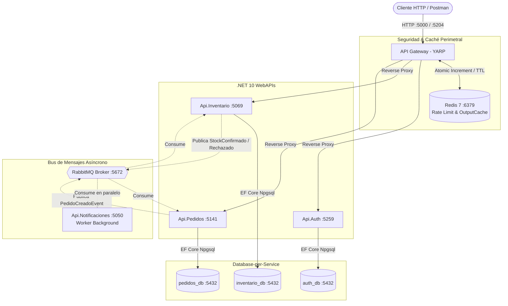
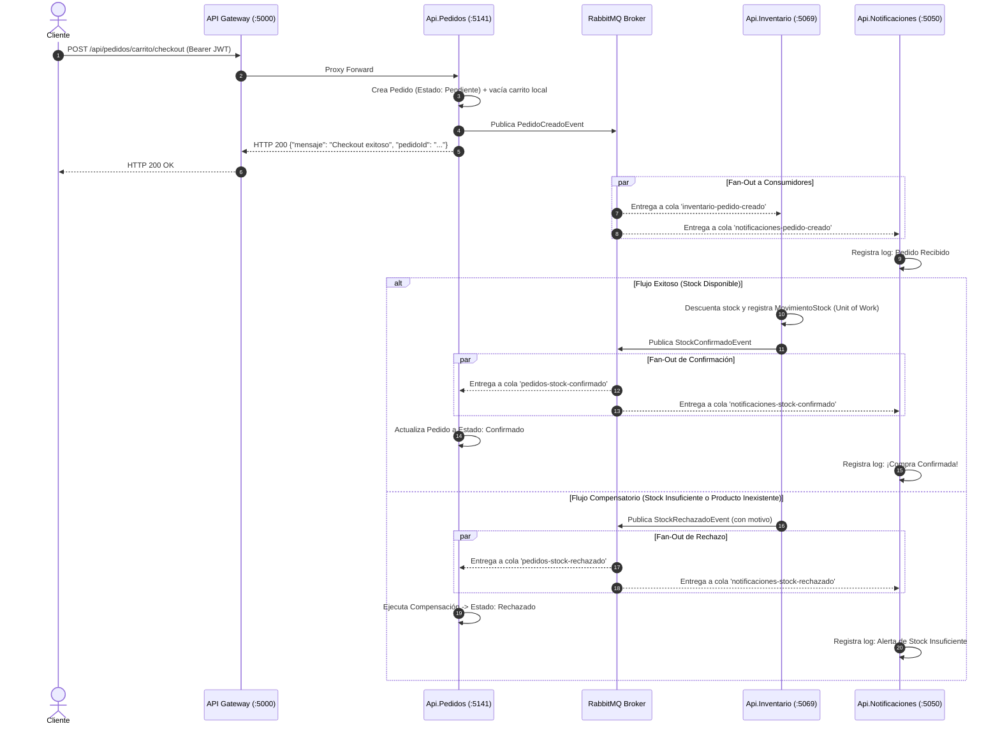

# E-Commerce Microservices Architecture

Backend para plataforma de comercio electrónico distribuida basado en microservicios, diseñado bajo principios de Clean Architecture y la metodología Twelve-Factor App, con comunicación asíncrona orientada a eventos para transacciones distribuidas resilientes.


---

## 1. Documentación Técnica en Profundidad (Wiki)

Para consultar detalles de diseño, modelos de dominio y diagramas entidad-relación de cada servicio:

* [01. Introducción y Objetivos Arquitectónicos](./docs/01-introduccion.md)
* [02. Arquitectura Orientada a Eventos y Patrón Saga](./docs/02-saga-rabbitmq.md)
* [03. API Gateway (YARP), Rate Limiting y Caché](./docs/03-componentes.md)
* [04. Microservicios y Dominios de Negocio](./docs/04-microservicios.md)
* [05. Infraestructura como Código y Despliegue](./docs/05-despliegue-e-infraestructura.md)

---

## 2. Contexto del Problema y Decisiones de Diseño

En las aplicaciones monolíticas de comercio electrónico, el checkout, la reserva de inventario, la autenticación y las notificaciones comparten el mismo ciclo de vida y la misma base de datos relacional (bloqueos transaccionales ACID globales). Ante picos masivos de demanda, un cuello de botella en inventario degrada todo el sistema.

Este proyecto resuelve ese problema desacoplando el dominio en **Bounded Contexts independientes** bajo el patrón **Database-per-Service**:
* **Aislamiento de fallos:** La caída temporal de un servicio satélite (como el envío de notificaciones) no bloquea la compra ni la persistencia del pedido.
* **Consistencia Eventual sin bloqueos distribuidos (Two-Phase Commit / 2PC):** Las transacciones entre servicios se gestionan mediante eventos asíncronos y transacciones compensatorias locales.
* **Escalabilidad Horizontal Independiente:** Servicios con alta demanda de lectura (Catálogo de productos) o de escritura intensiva (Checkout) pueden escalar réplicas de forma aislada.

---

## 3. Arquitectura del Sistema

### Diagrama General



### Tabla de Servicios e Infraestructura

| Servicio | Responsabilidad de Negocio | Puerto Host | Puerto Contenedor | Persistencia / Almacén | Dependencias |
| :--- | :--- | :---: | :---: | :--- | :--- |
| **Api.Gateway** | Punto único de entrada, Reverse Proxy YARP, Rate Limiting distribuido, Output Cache y validación de roles | `5000` / `5204` | `8080` | Memoria / Redis | Redis, Auth, Inventario, Pedidos |
| **Api.Auth** | Registro de usuarios, hasheo BCrypt de contraseñas y emisión de tokens JWT | `5259` | `8080` | PostgreSQL (`auth_db`) | PostgreSQL, RabbitMQ |
| **Api.Inventario** | Catálogo de productos, categorías, reserva transaccional y registro inmutable de movimientos de stock | `5069` | `8080` | PostgreSQL (`inventario_db`) | PostgreSQL, RabbitMQ |
| **Api.Pedidos** | Gestión de carritos activos, orquestación de checkout, creación de órdenes y Rate Limiting de compra | `5141` | `8080` | PostgreSQL (`pedidos_db`) | PostgreSQL, RabbitMQ |
| **Api.Notificaciones** | Worker en segundo plano para envío simulado de correos transaccionales y alertas operativas | `5050` | `8080` | Stateless (Sin BD) | RabbitMQ |
| **PostgreSQL** | Motor de base de datos relacional con inicialización multi-base (`init-multiple-dbs.sql`) | `5432` | `5432` | 3 bases de datos lógicas aisladas | — |
| **Redis** | Almacén en memoria de clave-valor para control de concurrencia y caché de salida | `6379` | `6379` | Almacenamiento en memoria | — |
| **RabbitMQ** | Broker de mensajería AMQP con consola de gestión web UI | `5672` / `15672` | `5672` / `15672` | Colas y Exchanges durables | — |

---

## 4. Decisiones Técnicas y Patrones

### Saga Coreografiada vs. Saga Orquestada
* **Elección:** Se implementó una **Saga Coreografiada**.
* **Motivo:** En un dominio de e-commerce centrado en el checkout, la coreografía evita introducir un servicio orquestador que actúe como cuello de botella o *Single Point of Failure (SPOF)*. Cada servicio domina sus propias reglas de negocio y reacciona de forma reactiva ante los eventos emitidos al bus.
* **Trade-off asumido:** La coreografía requiere un control más riguroso de observabilidad y trazabilidad, además de contratos de eventos compartidos fuertemente tipados ([SharedContracts](./src/Shared/SharedContracts)) para evitar divergencias entre productores y consumidores.

### Rol y Mecanismos de Redis
1. **Rate Limiting Distribuido Perimetral:** Ubicado en el Gateway ([RedisRateLimiter.cs](./src/ApiGateways/Api.Gateway/Data/RedisRateLimiter.cs)). Ejecuta operaciones atómicas `StringIncrementAsync` con expiración TTL (`KeyExpireAsync`). Limita a un máximo de 20 peticiones por minuto por dirección IP, bloqueando ráfagas o ataques de denegación de servicio antes de que lleguen a los microservicios.
2. **Output Caching:** Política `CatalogoCache` configurada en YARP sobre `/api/productos`. Las consultas al catálogo público se sirven directamente desde la memoria de Redis (expiración de 60 segundos), reduciendo drásticamente la carga sobre `Api.Inventario` y la base de datos PostgreSQL.

### Rol del API Gateway (YARP)
* Centraliza el punto de acceso para clientes externos, ocultando la topología interna de la red de contenedores.
* Aplica seguridad perimetral: valida firmas JWT y aplica autorización de roles (`AdminOnly` para mutaciones de productos en `/api/productos/{**catch-all}`) antes de reenviar la petición.
* Resuelve nombres mediante el DNS interno de Docker (`http://api.auth:8080`, `http://api.inventario:8080`, `http://api.pedidos:8080`).

---

## 5. Flujo Transaccional Distribuido (Checkout Saga)



---

## 6. Cómo Ejecutar el Proyecto

### Requisitos Previos
* [Docker Desktop](https://www.docker.com/products/docker-desktop/) (o Docker Engine con plugin Docker Compose v2+).
* Git.

### 1. Clonar el Repositorio
```bash
git clone https://github.com/fedeisla/e-commerce-microservicios-net.git
cd e-commerce-microservicios-net
```

### 2. Configurar Variables de Entorno
Copie la plantilla de variables de entorno incluida en la raíz:
```bash
cp .env.example .env
```
*(Los valores de `.env.example` están configurados para funcionar de inmediato en local).*

### 3. Levantar Todo el Sistema (1 solo comando)
```bash
docker compose up -d --build
```

El proceso compilará los Dockerfiles multi-stage de .NET 10 y levantará los 8 contenedores. Las dependencias declaradas con `condition: service_healthy` garantizan que los microservicios esperen a que PostgreSQL, Redis y RabbitMQ estén completamente listos.

Al arrancar, cada microservicio ejecuta de forma automática sus migraciones pendientes de Entity Framework Core (`Database.Migrate()`), aprovisionando tablas e índices sin intervención manual.

### 4. Verificar que Levantó Correctamente
```bash
docker compose ps
```
Los 8 contenedores deben figurar en estado `Up` o `Up (healthy)`.

Para seguir los eventos de la Saga en tiempo real:
```bash
docker compose logs -f api.pedidos api.inventario api.notificaciones
```

---

## 7. Cómo Probar el Sistema

### Opciones de Prueba
1. **Colección de Postman Incluida:** Importe el archivo [ECommerce.postman_collection.json](./ECommerce.postman_collection.json) directamente en Postman. Incluye scripts para capturar el token JWT automáticamente en la variable `{{bearer_token}}`.
2. **Swagger UI por Microservicio:**
   * **Api.Auth:** [http://localhost:5259/swagger](http://localhost:5259/swagger)
   * **Api.Inventario:** [http://localhost:5069/swagger](http://localhost:5069/swagger)
   * **Api.Pedidos:** [http://localhost:5141/swagger](http://localhost:5141/swagger)
3. **Consola de RabbitMQ:** [http://localhost:15672](http://localhost:15672) (Credenciales: `guest` / `guest`).

### Walkthrough con Comandos `curl`

#### Paso 1: Registrar un usuario
```bash
curl -s -X POST http://localhost:5000/api/auth/register \
  -H "Content-Type: application/json" \
  -d '{
    "nombre": "Juan",
    "apellido": "Perez",
    "email": "juan@test.com",
    "password": "Password123!"
  }'
```

#### Paso 2: Iniciar sesión y obtener JWT
```bash
TOKEN=$(curl -s -X POST http://localhost:5000/api/auth/login \
  -H "Content-Type: application/json" \
  -d '{"email": "juan@test.com", "password": "Password123!"}' | python3 -c "import sys, json; print(json.load(sys.stdin)['token'])")

echo "Token obtenido: $TOKEN"
```

#### Paso 3: Asignar Rol Admin (para crear productos)
Por defecto los usuarios se registran como `Cliente` (Rol 0). Para habilitar la creación de catálogo, modifique el rol a `Admin` (Rol 1) en PostgreSQL:
```bash
docker exec ecommerce_postgres psql -U admin -d auth_db -c "UPDATE \"Usuarios\" SET \"Rol\" = 1 WHERE \"Email\" = 'juan@test.com';"
```
*(Vuelva a ejecutar el Paso 2 para generar un JWT con claim de Admin).*

#### Paso 4: Crear producto e ingresar existencias
```bash
# Crear producto
PRODUCTO_ID=$(curl -s -X POST http://localhost:5000/api/productos \
  -H "Content-Type: application/json" \
  -H "Authorization: Bearer $TOKEN" \
  -d '{
    "sku": "TECLADO-RGB-01",
    "nombre": "Teclado Mecánico RGB",
    "precioBase": 85000,
    "stockDisponible": 10
  }' | python3 -c "import sys, json; print(json.load(sys.stdin)['idProducto'])")

# Ingresar 10 unidades de stock
curl -s -X POST http://localhost:5000/api/productos/movimientos \
  -H "Content-Type: application/json" \
  -H "Authorization: Bearer $TOKEN" \
  -d "{
    \"idProducto\": \"$PRODUCTO_ID\",
    \"motivo\": \"Ingreso de lote inicial\",
    \"cantidad\": 10
  }"
```

#### Paso 5: Agregar producto al carrito
```bash
curl -s -X POST http://localhost:5000/api/pedidos/carrito/items \
  -H "Content-Type: application/json" \
  -H "Authorization: Bearer $TOKEN" \
  -d "{
    \"productoId\": \"$PRODUCTO_ID\",
    \"productoNombre\": \"Teclado Mecánico RGB\",
    \"precioUnitario\": 85000,
    \"cantidad\": 2
  }"
```

#### Paso 6: Ejecutar el Checkout (Disparar Saga)
```bash
curl -s -X POST http://localhost:5000/api/pedidos/carrito/checkout \
  -H "Content-Type: application/json" \
  -H "Authorization: Bearer $TOKEN"
```
Retornará:
```json
{
  "mensaje": "Checkout exitoso. Pedido en proceso.",
  "pedidoId": "<GUID_DEL_PEDIDO>"
}
```

#### Paso 7: Comprobar la resolución asíncrona
```bash
docker exec ecommerce_postgres psql -U admin -d pedidos_db -c "SELECT \"Id\", \"Estado\", \"Total\" FROM \"Pedidos\" ORDER BY \"FechaCreacion\" DESC LIMIT 1;"
```
* **Caso Exitoso:** `Estado = Confirmado` y el stock en inventario se reduce a 8 unidades.
* **Caso Compensatorio:** Si intenta comprar una cantidad superior al stock existente (ej. 50 unidades), la Saga resuelve asíncronamente con `Estado = Rechazado`.

---

## 8. Tests y Pruebas Automatizadas

Actualmente la solución **no incluye proyectos de pruebas automatizadas** (`*.Tests.csproj`). 

La verificación del comportamiento transaccional distribuido se realiza de extremo a extremo (E2E) mediante la colección de Postman (`ECommerce.postman_collection.json`) y la suite de comandos `curl` documentada en la sección 7.

La implementación de pruebas unitarias y de integración forma parte prioritaria de las **Mejoras Futuras**.

---

## 9. Limitaciones Conocidas y Mejoras Futuras

### Limitaciones Actuales
1. **Transaccionalidad en Publicación (Falta de Outbox Pattern):** Actualmente, cada servicio guarda en su base de datos local y posteriormente publica en RabbitMQ (`_publishEndpoint.Publish`). Ante una caída de red o reinicio del broker exactamente entre ambas operaciones, podría generarse una inconsistencia transaccional.
2. **Clave Simétrica JWT Compartida:** Para fines de desarrollo local, todos los microservicios validan tokens utilizando la misma clave secreta compartida en configuración. En un entorno productivo estricto, se recomienda migrar a criptografía asimétrica (RSA / JWKS) respaldada por un proveedor OIDC dedicado (como Keycloak o Duende IdentityServer).
3. **Manejo de Roles en Autenticación:** La promoción al rol de `Administrador` se gestiona mediante actualización directa en base de datos (`UPDATE "Usuarios" SET "Rol" = 1`), al no existir un endpoint protegido de backoffice para la asignación de roles.

### Roadmap y Mejoras Futuras
- [ ] Incorporación de suite de tests unitarios (xUnit / NSubstitute / FluentAssertions).
- [ ] Tests de integración de microservicios con **Testcontainers** (instancias efímeras de PostgreSQL, Redis y RabbitMQ).
- [ ] Implementación de **Transactional Outbox Pattern** con MassTransit Outbox.
- [ ] Instrumentación de observabilidad y trazabilidad distribuida con **OpenTelemetry**, **Jaeger** y métricas en **Prometheus**.
- [ ] Endpoint seguro para gestión y escalado de roles de usuario desde Backoffice.


