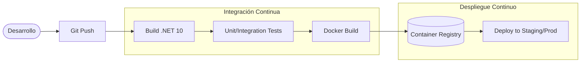

# 5. Infraestructura y Estrategia de Despliegue

Aunque el ecosistema de microservicios actualmente se ejecuta en un entorno de desarrollo local, la arquitectura fue diseñada bajo los principios de **Aplicaciones Nativas de la Nube (Cloud-Native)** y la metodología **Twelve-Factor App**. Esto garantiza que el sistema sea fácilmente portable, escalable y preparado para un despliegue en entornos productivos.


## 5.1 Infraestructura como Código (Docker Compose Integral)

Para garantizar la reproducibilidad del entorno y evitar el clásico problema de *"funciona en mi máquina"*, **todo el ecosistema** (API Gateway, microservicios de negocio, worker de notificaciones, persistencia en PostgreSQL, caché en Redis y mensajería en RabbitMQ) se encuentra **completamente contenerizado**.

Con un único comando:
```bash
docker compose up -d --build
```
se aprovisiona la infraestructura, se construyen las imágenes multi-stage optimizadas, se ejecutan las migraciones de base de datos de manera automática al inicializar cada API y se levanta el sistema completo listo para operar.

### Decisiones de Diseño en la Infraestructura Contenerizada:
* **Dockerfiles Multi-Stage:** Cada servicio cuenta con un Dockerfile en dos fases: compilación y restauración con SDK de .NET 10, y empaquetado final sobre la imagen ligera de runtime ASP.NET Core (`aspnet:10.0-preview`).
* **Seguridad y Principio de Menor Privilegio:** Los contenedores se ejecutan bajo el usuario no privilegiado `app` (UID 1654), exponiendo internamente el puerto `8080` vía `ASPNETCORE_HTTP_PORTS=8080`.
* **Aislamiento de Red:** Todos los servicios operan dentro de una red bridge (`ecommerce_network`), permitiendo la resolución de nombres por DNS interno de Docker (ej. `http://api.auth:8080`, `postgres:5432`, `rabbitmq:5672`).
* **Healthchecks y Dependencias Estrictas:** PostgreSQL (`pg_isready`), Redis (`redis-cli ping`) y RabbitMQ (`rabbitmq-diagnostics -q ping`) poseen healthchecks nativos. Los microservicios declaran `depends_on` con `condition: service_healthy`, asegurando que ninguna API intente iniciar o migrar antes de que la infraestructura esté 100% operativa.
* **Bootstrapping y Migraciones Automáticas:** El script `init-multiple-dbs.sql` crea automáticamente las bases de datos lógicas (`auth_db`, `inventario_db`, `pedidos_db`). Al iniciar, cada microservicio aplica automáticamente sus migraciones de Entity Framework Core (`Database.Migrate()`) en un scope de inicio.

<details>
<summary><b>Ver Arquitectura docker-compose.yml Integral</b></summary>

```yaml
services:
  postgres:
    image: postgres:15-alpine
    container_name: ecommerce_postgres
    healthcheck:
      test: ["CMD-SHELL", "pg_isready -U ${POSTGRES_USER:-admin}"]
      interval: 5s
      timeout: 5s
      retries: 5

  redis:
    image: redis:7-alpine
    container_name: ecommerce_redis
    healthcheck:
      test: ["CMD", "redis-cli", "ping"]
      interval: 5s
      timeout: 5s
      retries: 5

  rabbitmq:
    image: rabbitmq:3-management-alpine
    container_name: ecommerce_rabbitmq
    healthcheck:
      test: ["CMD", "rabbitmq-diagnostics", "-q", "ping"]
      interval: 10s
      timeout: 10s
      retries: 5

  api.auth:
    build:
      context: .
      dockerfile: src/Services/Api.Auth/Api.Auth.WebAPI/Dockerfile
    container_name: ecommerce_api_auth
    depends_on:
      postgres: { condition: service_healthy }
      rabbitmq: { condition: service_healthy }

  api.inventario:
    build:
      context: .
      dockerfile: src/Services/Api.Inventario/Api.Inventario.WebAPI/Dockerfile
    container_name: ecommerce_api_inventario
    depends_on:
      postgres: { condition: service_healthy }
      rabbitmq: { condition: service_healthy }

  api.pedidos:
    build:
      context: .
      dockerfile: src/Services/Api.Pedidos/Api.Pedidos.WebAPI/Dockerfile
    container_name: ecommerce_api_pedidos
    depends_on:
      postgres: { condition: service_healthy }
      rabbitmq: { condition: service_healthy }

  api.notificaciones:
    build:
      context: .
      dockerfile: src/Services/Api.Notificaciones/Dockerfile
    container_name: ecommerce_api_notificaciones
    depends_on:
      rabbitmq: { condition: service_healthy }

  api.gateway:
    build:
      context: .
      dockerfile: src/ApiGateways/Api.Gateway/Dockerfile
    container_name: ecommerce_api_gateway
    ports:
      - "5000:8080"
      - "5204:8080"
    depends_on:
      redis: { condition: service_healthy }
      api.auth: { condition: service_started }
      api.inventario: { condition: service_started }
      api.pedidos: { condition: service_started }
```
</details>


## 5.2 Gestión de Configuración y Secretos

En preparación para entornos productivos, el código fuente no contiene credenciales *hardcodeadas*. 
* **Desarrollo Local:** Las cadenas de conexión, claves de encriptación JWT y configuraciones de RabbitMQ/Redis se inyectan a través de los archivos `appsettings.json` o `appsettings.Development.json`.
* **Producción:** La arquitectura está preparada para que estos valores sean sobrescritos mediante **Variables de Entorno** a nivel del contenedor, o integrados con gestores de secretos corporativos (como Azure Key Vault o AWS Secrets Manager).


## 5.3 Pipeline Propuesto de Integración y Despliegue Continuo (CI/CD)

Si bien la ejecución actual es local, el diseño de los repositorios y la separación de dominios facilita la implementación de pipelines automatizados (ej. GitHub Actions, Azure DevOps). El flujo de trabajo estándar propuesto para escalar el proyecto hacia un entorno Cloud (como Azure Container Apps o Amazon ECS) sería el siguiente:


* **Ventaja del Ecosistema:** Al tener microservicios independientes, una actualización en la lógica de `Api.Inventario` dispara únicamente el pipeline de dicho servicio, permitiendo despliegues ágiles sin afectar la disponibilidad del resto del sistema.


## 5.4 Escalabilidad y Preparación para Orquestadores (Kubernetes / K8s)

El ecosistema fue rigurosamente codificado respetando el principio **Stateless** (sin estado local), lo que significa que la infraestructura está lista para ser migrada desde un entorno estático (Docker Compose) hacia un orquestador dinámico en la nube como Kubernetes (K8s) o Amazon ECS.

Esta preparación arquitectónica habilita los siguientes comportamientos corporativos:

* **Escalado Automático (HPA):** Un orquestador puede monitorear el consumo de CPU de `Api.Inventario` y levantar múltiples réplicas del contenedor automáticamente ante un pico de demanda, destruyéndolas cuando el tráfico baje.
* **Patrón Competing Consumers:** Al levantar múltiples instancias de un mismo microservicio, todas escuchan la misma cola en RabbitMQ. El Message Broker distribuirá automáticamente la carga de eventos de forma equitativa (Round-Robin) entre todos los contenedores disponibles, multiplicando la capacidad de procesamiento del sistema.
* **Consistencia Distribuida del Gateway:** Dado que YARP utiliza Redis como almacén externo para el Rate Limiting y la Caché, el Gateway puede escalar a "N" instancias. Si una IP maliciosa es bloqueada por la Instancia 1, la Instancia 2 compartirá esa información en tiempo real a través de Redis, manteniendo el cerco de seguridad perimetral intacto en toda la red.


## Gestión de Secretos y Configuración 

Para lograr un balance entre la experiencia de desarrollo local y los estándares de seguridad, este proyecto implementa el patrón de **Fallback de Variables de Entorno** y segmentación de configuraciones:

* **.NET AppSettings:** Los archivos `appsettings.json` principales (diseñados para Producción) se encuentran limpios en el repositorio y no exponen secretos, delegando la responsabilidad a la inyección de variables de entorno. La ejecución local sin fricción es posible gracias a los `appsettings.Development.json`, que contienen credenciales genéricas (ej. `Password123!`) y apuntan a `localhost`.
* **Docker Compose:** Utiliza la sintaxis de fallback (`${VAR:-default}`). Si el motor no detecta un archivo `.env` productivo, inyecta automáticamente valores por defecto seguros para desarrollo local, permitiendo que el proyecto funcione *out-of-the-box*. Ninguna credencial real de producción se encuentra expuesta en el control de versiones.

---

| <b><a href="./03-componentes.md">Anterior: API Gateway (YARP)</a></b> | <b><a href="../README.md">Volver al Inicio</a></b> |
| :--- | ---: |